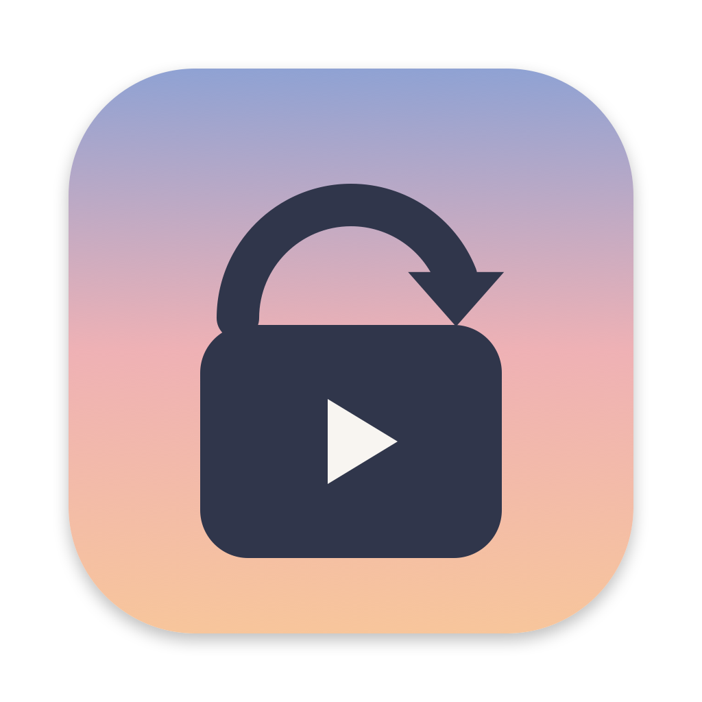

# Lockloop

Lockloop puts your own video or GIF on your Mac's lock screen.



Lockloop is not made by Apple and has nothing to do with Apple.

## Install

**Download.** Get `Lockloop.zip` from the Releases page of this repository. Unzip it and drag Lockloop to your Applications folder.

**The first time you open it.** Lockloop is signed ad hoc and not notarised by Apple, so macOS stops it the first time you open it. macOS says it could not verify that Lockloop is free of malware, and offers to move it to the Bin. Press Done, then open System Settings > Privacy & Security, scroll down, and press **Open Anyway** next to the line about Lockloop. You only need to do this once.

**Build it yourself.** You need Xcode or Apple's command line tools.

```sh
git clone https://github.com/estatheo/lockloop.git
cd lockloop
./scripts/make-app.sh
```

The app appears in `build/Lockloop.app`, with a zip beside it.

**Which macOS.** Lockloop was built and tried on macOS 27.2 on an Apple silicon Mac, where the video plays on the lock screen and the undo puts Apple's video back exactly as it was. That is the only version it has been tried on.

## How to use it

1. Drop a video or GIF on the window. MP4, MOV, M4V and GIF all work. You can also press Choose File.
2. Press **Use on lock screen**.
3. Lock your Mac with Ctrl+Cmd+Q.

**Fit or Fill.** Fit shows the whole picture and fills the space around it with a colour taken from the picture's edges. Fill covers the whole screen and cuts off the edges of the picture. The preview shows what you will get.

Your desktop shows the video as well. macOS uses the same wallpaper for both.

## Undo

Open Lockloop and press **Restore Apple's wallpaper**. Apple's video goes back, the wallpaper you had before comes back, and Lockloop deletes its copy of your video. Your own file is never changed.

From the command line: `lockloop restore`.

To remove Lockloop completely: turn off Keep it applied, press Restore Apple's wallpaper, delete the app, then delete `~/Library/Application Support/Lockloop`.

## How it works

macOS only animates the lock screen for its own moving wallpapers, the aerials. A screen saver doesn't show there.

Each aerial is a video file in your own Library. Lockloop converts your clip into the same kind of file, puts it in the place of one of Apple's aerials, and chooses that aerial as your wallpaper. It keeps Apple's file so you can put it back.

For the curious:

- The aerials live in `~/Library/Application Support/com.apple.wallpaper/aerials/videos/<ID>.mov`, and the catalogue that names them is `aerials/manifest/entries.json`.
- Lockloop writes HEVC video tagged `hvc1`, 3840 × 2160, 30 frames a second or less, about 5 minutes long, with no sound. That matches the size and codec of Apple's own files. Lockloop converts one loop of your clip and repeats it to make 5 minutes, which is much quicker than converting all 5 minutes.
- It chooses the wallpaper by editing `~/Library/Application Support/com.apple.wallpaper/Store/Index.plist`, then restarts `WallpaperAgent` so macOS reads the change. It only edits the desktop entries. Your screen saver setting is left alone.
- Before it changes anything, it saves Apple's video and a copy of `Index.plist` in `~/Library/Application Support/Lockloop`.
- It only ever replaces one of Apple's aerials. If one is already on your Mac, it uses that one. If none is, it offers to download one from Apple, or you can choose one in System Settings > Wallpaper.

On the Mac it was built on (an M5 Pro), a 14-second 1080p clip took about 7 seconds to convert and came out at 272 MB. A 1.6-second GIF took about 3 seconds and came out at 356 MB.

## What can break it, and why

- Lockloop relies on parts of macOS that Apple hasn't documented. A macOS update can change them, and then Lockloop stops working until it is updated.
- macOS can download Apple's video again and overwrite yours, for example after an update. Lockloop notices this the next time you open it and offers to put yours back. If you turn on **Keep it applied**, it checks when you log in and once an hour, and puts yours back by itself. That check runs as a small background item in `~/Library/LaunchAgents`, which you can see and remove.
- Your desktop shows the video too. There is no way to have it on the lock screen only.
- macOS crops the video to fit screens that aren't 16:9, such as most MacBook screens. Fit allows for the shape of your main screen, so the whole picture stays visible there.
- If you have different wallpapers on different displays or Spaces, Lockloop sets all of them to your video.
- Lockloop turns off wallpaper shuffle for the desktop, because a shuffle would move away from your video.

## Questions

**Why isn't this a screen saver?**
macOS doesn't show custom screen savers on the lock screen. Only Apple's moving wallpapers play there, so Lockloop uses one of those.

**Does it use more battery?**
We haven't measured it. Your Mac plays your video the same way it plays Apple's moving wallpapers.

**Does it work on older macOS?**
Not yet. On macOS 14 and 15, Apple keeps these videos in a system folder that needs an administrator password. Lockloop only changes files in your own Library, so on those versions it tells you this and changes nothing.

**Is there sound?**
No. Lockloop leaves the sound out, as Apple's wallpapers have none.

**What happens to my original file?**
Nothing. Lockloop reads it and leaves it where it is.

## Privacy

Lockloop doesn't collect anything and doesn't phone home. It uses the network in one case: when you ask it to download one of Apple's moving wallpapers, it fetches that file from Apple's server, `sylvan.apple.com`.

## Command line

The app carries a command line tool at `Lockloop.app/Contents/Helpers/lockloop`. To use it from a terminal, link it somewhere on your `PATH`, for example:

```sh
ln -s /Applications/Lockloop.app/Contents/Helpers/lockloop ~/.local/bin/lockloop
```

| Command | What it does |
|---|---|
| `lockloop set <file> [--fill]` | Converts the file and puts it on the lock screen. Add `--download <asset-id>` to fetch an aerial from Apple first, and `--keep` to turn on Keep it applied. |
| `lockloop restore` | Puts Apple's wallpaper back. |
| `lockloop status [--json]` | Says what is applied. When nothing is, it lists the aerials on your Mac. |
| `lockloop keep on` or `off` | Turns Keep it applied on or off. |
| `lockloop reapply` | Puts your video back if macOS replaced it. The background check runs this. |

Exit codes: 0 done, 1 failed, 2 wrong usage, 3 this macOS isn't supported, 4 an aerial needs downloading first.

## For developers

```sh
swift build
swift test
```

The tests never touch your real wallpaper. They build a fake wallpaper folder in a temporary directory.

To try the app or the command line tool safely, set `LOCKLOOP_ROOT` to a folder. Lockloop then treats that folder as your home, never restarts `WallpaperAgent` and never loads a background item. The window title says "test mode" while this is on.

```sh
LOCKLOOP_ROOT=/tmp/lockloop-test build/Lockloop.app/Contents/MacOS/Lockloop
```

The product name lives in `Sources/AerialKit/Brand.swift`. Renaming starts there.

## Licence

MIT. See [LICENSE](LICENSE).

Lockloop is not made by Apple and has nothing to do with Apple. macOS and Mac are trademarks of Apple Inc.
